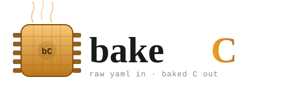

# bakeC




> **Raw YAML in. Baked C out.**

bakeC is a personal Python code generator exploring selected embedded
code-generation patterns. It turns YAML models and platform configurations into
readable C, with `initialize`/`step`/`terminate` lifecycle functions, separate
calibration arrays, and model-to-code traceability.

The project separates parsing, model validation and template rendering. It is
inspired by patterns used in embedded code-generation tools, including MATLAB
Embedded Coder; it is not a reimplementation of that product or a drop-in replacement.

## Generated output

Each model produces four files:

| File | Contents |
|---|---|
| `{name}_controller.h` | Public I/O structs and lifecycle prototypes |
| `{name}_controller.c` | Algorithm and lifecycle implementation |
| `{name}_controller_data.c` | Calibration arrays for basis functions and lookup tables |
| `{name}_controller_types.h` | Platform-specific typedefs |

PID gains and scalar offsets currently remain in the algorithm file. Traceability
comments record source paths, SHA-256 hashes, generator version and block references.
They identify inputs; they do not prove that generated behavior is correct.

## Quick start

Requires Python 3.10+, a C99 compiler (`cc` or GCC), CMake 3.16+ and Make.
The Python suite includes tests that compile and execute generated C, so a C
compiler is required for the full suite. On Windows, MSYS2 with MinGW-w64 can
provide the build tools.

```bash
git clone https://github.com/manju89jay/bakeC.git
cd bakeC
pip install -e ".[dev]"
make all
```

`make all` generates all nine supplied model/platform combinations, builds and
executes three desktop C test programs, runs the Python suite (including generated-C
behavior tests and golden-file comparisons), and runs configured validation checks.
Regression and API-stability validation categories are **skipped without a baseline**;
the CLI reports those skips. Golden-file tests are a separate comparison against
committed generated files.

Generation and text-based validation can also run without a compiler:

```bash
python -m bakec.cli generate --model models/lung_mnarx.yaml \
  --platform platforms/desktop.yaml --output generated/desktop/
python -m bakec.cli validate --target generated/desktop/ \
  --rules src/bakec/checks/rules.yaml --platforms-dir platforms/
```

## Models and numerical behavior

- **mNARX Lung** — a nonlinear autoregressive lung-mechanics example with
  pressure-dependent basis functions, based on
  [Jayaramaiah et al. (2016)](https://www.scirp.org/journal/paperinformation?paperid=70763).
  See [model background](docs/model_background.md).
- **PID Controller** — proportional, integral and derivative terms with optional
  output saturation and integral clamping. Initialization resets the state used
  by computation, including configured initial values.
- **Lookup Table 1D** — piecewise linear interpolation with clamped extrapolation.

Real-valued model parameters use centralized C literal formatting: round-trip
precision for IEEE binary32 (`float`) and binary64 (`double`). Generation rejects
non-finite values, overflow, nonzero values that round to zero, and knots,
breakpoints or PID limits that collapse after conversion to target precision.
Ordinary rounding still occurs; runtime arithmetic can overflow or lose precision
and must be tested for the intended input range.

Compiled-C regression tests cover PID reset and initial state, small sample periods
and gains, fractional saturation limits, small coefficients and lookup boundaries.
Both `float` and `double` configurations are executed on the host. These checks do
not establish identical behavior on every embedded target. The older handwritten
Python precision comparisons remain useful numerical experiments, not evidence
about generated C execution.

## Architecture

**Generate:** YAML → parser/schema validation → semantic validation → Jinja2 engine → C files

**Validate:** C files + optional baseline → configured heuristic checks → findings and execution status

```text
src/bakec/
  parser.py          YAML and JSON Schema validation
  validator.py       Semantic model checks
  engine.py          Template context, state binding and C literal formatting
  templates/         File templates and block implementations
  writer.py          Generated file output
  cli.py             Generate and validate commands
  checks/            Configurable validation categories
```

See [architecture](docs/architecture.md), [TLC mapping](docs/tlc-mapping.md) and
[automotive mapping](docs/automotive-mapping.md) for design parallels and scope.

## Target verification

| Configuration | Precision | Demonstrated verification path |
|---|---|---|
| Desktop | `double` | Compiled and executed with host C tests |
| Cortex-M4 | `float` | Cross-compilation with `arm-none-eabi-gcc` in GitHub CI; no hardware execution shown |
| AURIX TC397 | `float` | Generation/configuration support; the pipeline does not demonstrate target compilation or hardware execution |

SIL 2/PLd, EtherCAT, watchdog, memory-budget and related platform metadata describe
configuration context. They do not establish implemented fieldbus or safety
functionality, certification, timing guarantees, enforced resource budgets or
verified deployment. See [safety context](docs/safety-context.md).

## Validation scope

The MISRA-related functionality consists of **heuristic checks inspired by selected
MISRA C:2012 rules**. Nine text-pattern checks are available; they do not cover
those rules completely and do not establish MISRA compliance. The former narrowing
heuristic was removed because it inferred types from variable names. Narrowing
conversions and other semantic type analysis require a C analyser.

| Category | Scope / prerequisite |
|---|---|
| MISRA-inspired | Nine heuristic checks; individual checks can be disabled |
| Traceability | Provenance banners, trace tags and source hashes |
| Safety patterns | Selected text patterns such as allocation calls and loop forms |
| Platform constraints | Requires `--platforms-dir`; checks available platform declarations |
| Regression | Requires an independent baseline directory |
| API stability | Requires an independent baseline directory; compares header contracts |

Validation fails on an empty target or an explicitly invalid baseline. Reports list
executed categories and skipped categories with reasons. A clean report means no
findings from the executed checks, not proof of correctness or safety. Compile and
execute generated code as part of verification.

To compare with a retained earlier output, provide its directory explicitly:

```bash
python -m bakec.cli validate --target generated/desktop/ \
  --baseline /path/to/earlier-output/desktop/ \
  --rules src/bakec/checks/rules.yaml --platforms-dir platforms/
# Or compare all platforms using a tree containing their respective subdirectories:
make validate BASELINE_DIR=/path/to/earlier-output
```

Do not use the target directory itself as its baseline. Keep a separately reviewed
output version for meaningful comparisons.

## Development

| Target | Behavior |
|---|---|
| `make install` | Install package and development dependencies |
| `make generate` | Generate all nine model/platform combinations |
| `make build` | Compile desktop libraries and C tests |
| `make test` | Run Python tests, build desktop output and execute C tests |
| `make validate` | Run applicable checks; baseline comparisons are optional |
| `make all` | Generate, build, test and validate |

After changing generation logic, regenerate committed outputs and verify numerical
behavior as well as golden files. Test counts and coverage do not replace behavioral
assertions.

## Documentation

- [Architecture](docs/architecture.md)
- [TLC Mapping](docs/tlc-mapping.md)
- [Automotive Mapping](docs/automotive-mapping.md)
- [Embedded Coder concept comparison](docs/simulink-comparison.md)
- [Safety Context](docs/safety-context.md)
- [Model Background](docs/model_background.md)
- [Architecture Decision Records](docs/decisions/)
- [Adding a Model](docs/adding-a-model.md)

## License

MIT.
